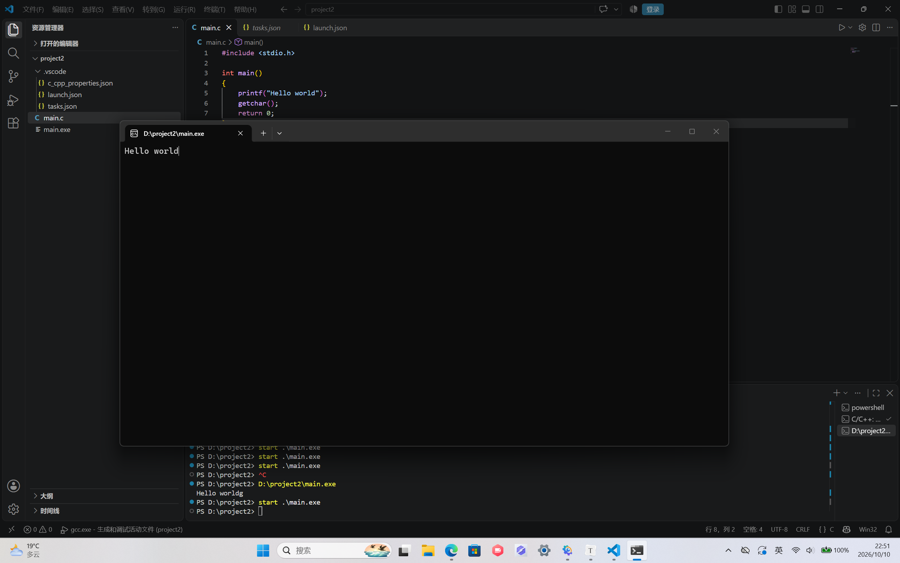
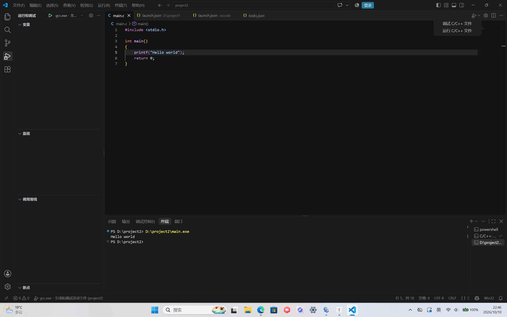
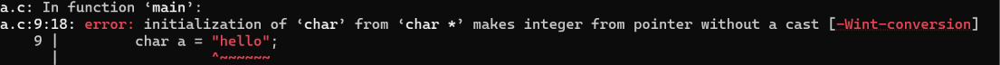
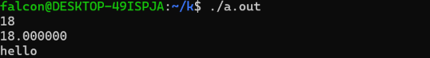
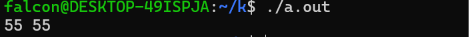
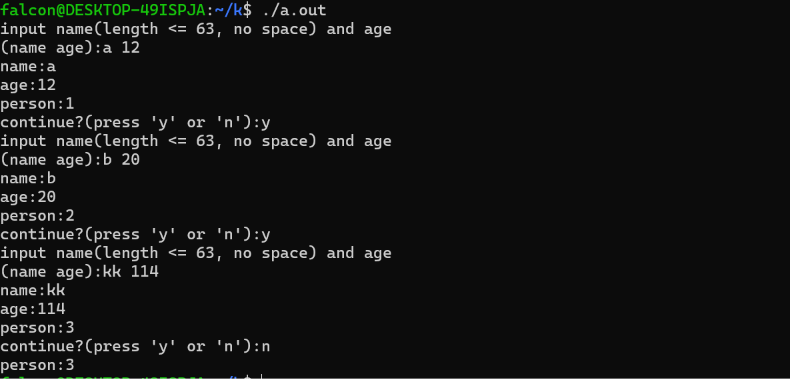
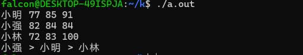

# C-EASY-1：C语言入门

## part1_了解C语言配置文件

**什么是GCC，什么是MinGW？它的作用是什么？**

**GCC**：GNU Compiler Collection，GNU 编译器集合。

**GCC**用来编译.c文件或.cpp文件

**MinGW**：Minimalist GNU for Windows，Windows 上的 GNU 工具链移植版。

**MinGW**是一套工具箱，在Windows上提供

**c_cpp_properties.json launch.json tasks.json这三个文件分别有什么作用？**

c_cpp_properties.json给C/C++插件用的，主要配置IntelliSense，也就是代码补全、跳转、错误波浪线、头文件提示

launch.json给 VS Code 的任务系统用的，定义“怎么编译”。

tasks.json给调试器用的，定义“怎么调试”。

**为什么要在编辑器内下载C语言的插件，插件的作用又是什么？**

插件让 VS Code 能调用 GCC、GDB，并提供更好的编辑体验

安装 **C/C++ 插件**，比如 Microsoft 的 C/C++ 扩展后，可以获得：

- 语法高亮增强
- 自动补全
- 参数提示
- 悬停查看定义
- 跳转到定义/声明
- 查找引用
- 错误检查
- 代码格式化
- 调试支持
- 生成 `tasks.json`、`launch.json` 模板

[AI对话链接](https://chat.deepseek.com/a/chat/s/a014b79c-cf6b-4241-9e53-2877b3d1be2b)


**这是一个launch.json的文件，请你补全上面的注释，并尝试更改你自己的设置，然后用外置终端和内置终端分别打印“hello world”并上传你输出结果的截图。**

```json
{
    // 使⽤ IntelliSense 了解相关属性。
    // 悬停以查看现有属性的描述。
    // 欲了解更多信息，请访问: https://go.microsoft.com/fwlink/?linkid=830387     "version": "0.2.0",
    "configurations": [
        {
            "name": "gcc.exe - ⽣成和调试活动⽂件",  // 该调试任务的名字，启动调试时会在待选列表中显⽰
            "type": "cppdbg", //使用C/C++调试器
            "request": "launch", //启动全新的程序来调试好像有一个main.exe，attach是附加在原程序上
            "program": "${fileDirname}\\${fileBasenameNoExtension}.exe", //调试的文件路径 fileDirname是文件所在文件夹的路径，fileBasenameNoExtension是文件名去掉.c
            "args": [], //传给main的参数
            "stopAtEntry": false,  // 是否在main函数的第一行自动暂停
            "cwd": "${workspaceFolder}", //工作目录（Current Working Directory），当前打开的项目根目录
            "environment": [], //程序运行环境中的环境变量
            "externalConsole": true,  //是否使用外部控制台窗口
            "MIMode": "gdb", //使用 GDB 作为底层调试后端
            "miDebuggerPath": "C:\\mingw64\\bin\\gdb.exe",  //指明电脑上 GDB 调试器的具体路径
            "setupCommands": [
                {
                    "description": "为 gdb 启⽤整⻬打印",//让 GDB 在调试时，把 C++ 里的 STL 容器（如 vector, map）或复杂的结构体以更易读的格式打印出来
                    "text": "-enable-pretty-printing",//际发给 GDB 的命令
                    "ignoreFailures": true//if启用失败，不报错，继续调试
                }
            ],
            "preLaunchTask": "C/C++: gcc.exe build active file"  // 调试前的预执⾏任务，这⾥的值是tasks.json⽂件中对应的编译任务，也就是调试前需要先编译
        }
    ]
}
```





## part2_C语言基础

**变量类型**： 什么是变量的类型？它为什么重要？如果你想存放你的年龄（比如 18），应该选择哪种基本变量类型（如整数、浮点数）？如果你想存放单词 “apple”，使用一个char类型的字符变量能实现吗？尝试编程验证你的想法，并思考正确的存储方式应该是什么？

变量的类型是给各种变量的分类，变量的类型提升可读性，保证操作合法，明确内存布局；选择整数，因为年龄一般是自然数；不能实现，一个char类型字符只能存储一个字母；应该用大小为6及以上的char数组储存

```c
#include <stdio.h>
#include <stdlib.h>


int main()
{
        int age = 18;
        float age1 = 18;
        char a = "hello";
        char a1[6] = "hello";
        printf("%d\n%lf\n%c\n%s\n", age, age1, a, a1);
        return 0;
}
```



修改

```c
#include <stdio.h>
#include <stdlib.h>


int main()
{
        int age = 18;
        float age1 = 18;
        char a1[6] = "hello";
        printf("%d\n%lf\n%s\n", age, age1, a1);
        return 0;
}
```



**数组的起始与边界**： 数组的第一个元素下标通常是从 0 还是 1 开始？访问数组元素时，下标超出其有效范围（例如，长度为 5 的数组访问 arr[5] 或 arr[-1]）会导致什么问题？为什么数组越界是一个常见的、危险的错误？

从0开始；会导致段错误

因为写着写着会忽略数组边界，在多层、复杂循环中很容易导致数组越界

越界读：可能读到垃圾数据、泄露内存信息。

越界写：会覆盖重要内容，导致崩溃、数据损坏或程序行为诡异。

**流程控制 - 循环结构**： 循环结构（如 for, while）是如何控制代码块重复执行的？请分别简述它们的基本结构。for 循环的初始化、条件判断和迭代部分各自的作用是什么？while 循环和 do…while 循环在首次执行条件判断上有何关键区别？尝试用两种不同的循环结构实现同一个任务（例如，计算 1 到 10 的和），体会它们的异同。

循环结构通过条件判断 + 跳转控制代码块反复执行：条件为真就执行循环体，执行完再回到判断处；条件为假就退出循环。

初始化：设置循环变量初值，例如 `int i = 1`，只做一次。

条件判断：每轮开始前检查，决定是否继续循环，例如 `i <= 10`。迭代**：每轮循环体后更新循环变量，使循环趋向结束，例如 `i++`。

`while`：先判断，后执行，可能一次都不执行。

`do…while`：先执行，后判断，至少执行一次。

```c
#include <stdio.h>

int main()
{
        int sum = 0, sum1 = 0, i = 1;
        while (i <= 10)
        {
                sum += i;
                i++;
        }
        i = 1;
        do {
                sum1 += i;
                i++;
        } while (i <= 10);
        printf("%d %d\n", sum, sum1);
        return 0;
}
```



**流程控制 - 逻辑表达式**：在条件判断（如 if, else if）和循环条件中使用的逻辑表达式（如age > 18 && score >= 60）与算术表达式（如a + b * c）有何本质区别(尝试从运算对象和运算结果分析)？运算逻辑符&&,||,!的含义分别是什么？尝试编写包含多个条件的逻辑表达式并预测其输出结果。

|          | 算术表达式               | 逻辑表达式                               |
| :------- | :----------------------- | :--------------------------------------- |
| 例子     | `a + b * c`              | `age > 18 && score >= 60`                |
| 运算对象 | 通常是数值：整数、浮点数 | 通常是布尔值，或能产生布尔值的比较表达式 |
| 运算符   | `+ - * / %` 等           | `&& || !`，常配合 `> < >= <= == !=`      |
| 运算结果 | 一个数值                 | 一个布尔值：真 / 假                      |
| 主要用途 | 计算数据                 | 控制流程：`if`、`while` 等条件判断       |

|          |                                         |
| -------- | --------------------------------------- |
| A && B   | 只有 A 和 B **都为真**，结果才为真。    |
| A \|\| B | A 和 B 中**至少一个为真**，结果就为真。 |
| !A       | A 为真，结果为假。 A 为假，结果为真。   |

int age = 20, score = 75;

bool isStudent = true;

`(age > 18 && score >= 60) || !isStudent`

= (真 && 真) || 假
= 真 || 假 = 真

你恍然大悟，尝试对程序进行了修改，以期可以实现如下功能：

1. 设置合适的变量用于存储输入的姓名与年龄。
2. 利用设置的变量，以原格式打印姓名与年龄。
3. 在每一次的读取输入->打印内容结束后，记录进行过读取输入->打印内容操作的次数，打印提示询问用户是否继续输入。
4. 若判断得到用户需要继续输入，则重复之前的读取输入->打印内容操作。
5. 若判断得到用户不需要继续，则打印记录的进行的读取输入->打印内容操作次数，然后结束程序。

```c
#include <stdio.h>

typedef struct{
        char name[64];
        int age;
} Person;

Person p[100];
int cnt;

int main()
{
        char opt = 'y';
        while (opt != 'n' && cnt < 100)
        {
                cnt++;
                printf("input name(length <= 63, no space) and age\n(name age):");
                scanf("%s%d", p[cnt].name, &(p[cnt].age));
                printf("name:%s\nage:%d\nperson:%d\n", p[cnt].name, p[cnt].age, cnt);
                printf("continue?(press 'y' or 'n'):");
                scanf(" %c", &opt);
        }
        printf("person:%d\n", cnt);
        return 0;
}
```




## part3_函数

**尝试利用自定义函数将main()函数的下列内容精简**：

利用自定义函数，实现乘方的计算（用于方差的计算）。（代码复用）

利用自定义函数，将三人的综合成绩计算的过程进行封装。（代码复用）

将综合成绩的排序，利用自定义函数进行封装。（逻辑组织）

```c
#include <stdio.h>
#include <wchar.h>
#include <locale.h>

typedef struct{
	double x[3], ave, var, sc;
	wchar_t name[5];
}Person;

int p[3];
Person ps[3];

double average(double x[3])
{
	return (x[0]+x[1]+x[2])/3;
}

double variance(double x[3])
{
	double xb = average(x);
	return ((x[0]-xb)*(x[0]-xb)+(x[1]-xb)*(x[1]-xb)+(x[2]-xb)*(x[2]-xb))/3;
}

double score(double x[3])
{
	return average(x)*3-variance(x)/3;
}

void sort(int p[3])
{
	for (int i = 0; i < 2; i++)
		for (int j = i+1; j < 3; j++)
			if (ps[p[i]].sc < ps[p[j]].sc) p[i]^=p[j]^=p[i]^=p[j];
}


int main()
{
	setlocale(LC_ALL, "");
	for (int i = 0; i < 3; i++)
	{
		wscanf(L"%ls%lf%lf%lf", ps[i].name, ps[i].x, ps[i].x+1, ps[i].x+2);
		ps[i].ave = average(ps[i].x);
		ps[i].var = variance(ps[i].x);
		ps[i].sc = score(ps[i].x);
		p[i] = i;
		printf("%lf ", ps[i].sc);
	}
	sort(p);
	wprintf(L"%ls > %ls > %ls\n", ps[p[0]].name, ps[p[1]].name, ps[p[2]].name);
	return 0;
}
```




猜猜下列函数的效果(你可以自行运行，看看结果怎么样)，**尝试从值传递的角度入手，说说为什么会这样**

```c
void swap(int a, int b){
  int temp = a;
  a = b;
  b = temp;
}

int main(){
  int a = 10;
  int b = 20;
  swap(a, b);
}
```

交换a，b的值

首先第一步：temp = 10, a = 10, b= 20;

第二步：temp = 10, a = 20, b = 20;

第三步：temp = 10, a = 20, b =10.


怎么修改函数才能真正实现值交换的效果呢？请你初步了解指针。

指针变量存放的是内存地址，通过这个地址可以找到并操作原来的变量