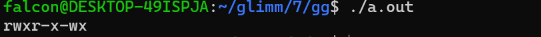
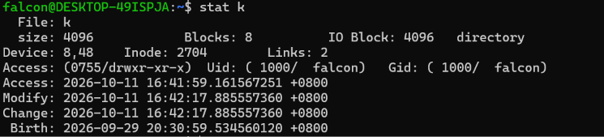
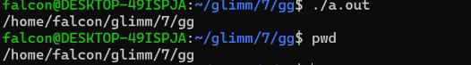
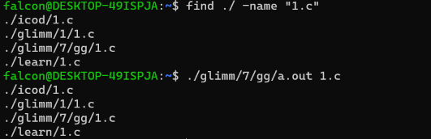

<h1>MEDIUM-3：初识Linux系统
## 【任务 1.1：不同的路】

**请解释什么是绝对路径，什么是相对路径**
绝对路径:从根目录一直往下到目标文件
相对路径:从pwd所在的目录为起点到目标文件
**假设你现在正处于/home/lin/workspace/，请分别写出前往 /var/backups/turing/ 的绝对路径命令和相对路径命令(假设 cd 命令还能用)。**
绝对路径: `cd  /var/backups/turing`
相对路径:`cd ../../../var/backups/turing`


<h2>【任务 1.2：何处启程】
`int main(int argc, char *argv[])`
**简要解释主函数参数 argc 与 argv[] 的含义是什么。  **  
argc: 命令行参数数量(至少为一，是程序名称 *.out)
argv[0]:程序名称
argv[1~(argc-1)]: 用户输入的参数
argv[argc] =NULL

**针对上述命令，请问 argc 的值是多少？argv[0]、argv[1]、argv[2] 分别指向什么字符串？**
~~上述命令呢,算了自己写~~
`./a.out k`
agrc = 2
argv[0] = "./a.out"
argv[1] = "k"
argv[2] = NULL

<h2>【任务 2.1：非同寻常之物】
**以上哪些头文件是你见过的，哪些是你没见过或者很少见到的？**
见过:<stdio.h><string.h><stdlib.h>
少见:<time.h>(生成随机数有用)
没见过<dirent.h><sys/stat.h><sys/types.h>

**<dirent.h> 和 <sys/stat.h> 分别提供了哪些关键的结构体或函数？它们分别有什么作用?（简要回答即可，不用详细列举所有作用）**

`<dirent.h>`

关键类型/结构体：`DIR`、`struct dirent`（如 `d_name`、`d_ino` 等字段）。`DIR`表示一个目录，`dirent`主要用来获取文件名和类型

关键函数：`opendir()`、`readdir()`、`closedir()`,作用分别为打开指定目录，返回目录流指针 `DIR *`；从DIR中遍历文件和子目录；关闭目录

`<sys/stat.h>`

关键结构体：`struct stat`（如 `st_mode`、`st_size`、`st_uid`、`st_gid`、`st_mtime` 等字段）。

关键函数：`stat()`获取文件状态；`chmod()`改权限；

<h2>【任务 2.2：看看权限】
**原生 ls -l 命令能打印出文件的权限，如 rwxr-xr-x。但在底层，文件权限被存储在一个名为 st_mode 的整数中。(请思考：整数如何表示文件的权限)**
状态压缩
九位二进制数，从高到低分别对应用户的wxr,组的wxr,其他的wxr

```c
#include <stdio.h>
#include <dirent.h>
#include <sys/stat.h>
#include <sys/types.h>

void parse_permissions(mode_t mode, char *perms)
{
        char rwx[] = {'r','w','x'};
        for (int i = 0; i < 3; i++)
                for (int j = 0; j < 3; j++)
                        perms[i*3+j] = (mode>>((2-i)*3+(2-j))&1)? rwx[j]: '-';//分成3组
        perms[9] = '\0';
}

int main()
{
        char perms[10];
        parse_permissions(0753, perms);
        printf("%s\n", perms);
        return 0;
}
```




**【任务 3.1：万物皆 Inode】**

  *An inode is a data structure on a filesystem on Linux and other Unix-like operating systems that stores all the information about a file except its name and its actual data. 
  ...
  Whereas a file contains only its own content and a directory holds only the names of the files that appear to the user to be contained in it and their inode numbers, an inode contains all the other information describing a file. This metadata includes (1) the size of the file (in bytes) and its physical location (i.e., the addresses of the blocks of storage containing the file's data on a HDD), (2) the file's owner and group, (3) the file's access permissions (i.e., which users are permitted to read, write and/or execute the file), (4) timestamps telling when the inode was created, last modified and last accessed and (5) a reference count telling how many hard links point to the inode.*——https://www.linfo.org/inode.html
这段英文的中文翻译如下：
inode 是 Linux 和其他类 Unix 操作系统文件系统上的一种数据结构，它存储关于文件的所有信息，但文件名和文件的实际数据除外。
...
文件只包含其自身内容，目录只保存用户看来包含在其中的文件的名称及其 inode 编号，而 inode 则包含描述文件的所有其他信息。这些元数据包括：1. 文件大小（以字节为单位）及其物理位置（即硬盘驱动器上包含文件数据的存储块的地址）；

2. 文件的所有者和组；
3. 文件的访问权限（即允许哪些用户读取、写入和/或执行该文件）；
4. 时间戳，说明 inode 的创建时间、最后修改时间和最后访问时间；
5. 引用计数，说明有多少硬链接指向该 inode。

**请简述 Inode 中存储了文件的哪些信息？**
1.文件大小(单位为Byte)和物理位置
2.文件的所有者和组
3.文件的访问权限
4.时间戳
5.引用计数


**Inode中不包含文件的什么信息？**
不包含文件名和其中的具体内容

**每一个目录下必定存在两个隐藏的特殊目录："." 和 ".."它们分别代表什么？它们的 Inode 编号在系统根目录"/"下有什么特殊规律？**
"."代表当前目录，".."代表父亲目录
由于根目录没有父亲目录，所以规定".."指向根目录自己，所以根目录下".","..","/"的inode一样


**[任务 3.2：寻我来时路】**

```c
#include <stdio.h>
#include <stdlib.h>
#include <string.h>
#include <unistd.h>
#include <sys/stat.h>
#include <dirent.h>

#define MAXLEN 4096

ino_t get_inode(const char *path) {
	struct stat statbuf;
	if (stat(path, &statbuf) == -1) 
	{
	        perror("stat failed");
	       exit(EXIT_FAILURE);
	}
	return statbuf.st_ino;
}

char *getName(ino_t son)
{
	DIR *dir = opendir(".");
	struct dirent *entry = readdir(dir);
	for (; entry && entry->d_ino != son; entry = readdir(dir)) ;
	char *ret = (char *)malloc(sizeof(char)*MAXLEN);
	memcpy(ret, entry->d_name, strlen(entry->d_name)+1);
	closedir(dir);
	return ret;
}

void dfs(ino_t son)
{
	if (get_inode(".") == get_inode("..")) 
	{
		char *sonName = getName(son);
		printf("/%s", sonName);
		free(sonName);
		return;
	}
	char *sonName = getName(son);
	ino_t thiss = get_inode(".");
	chdir("..");
	dfs(thiss);
	printf("/%s", sonName);
	free(sonName);
}

void myPwd()
{
	ino_t thiss = get_inode(".");
	if (get_inode(".") == get_inode("..")) 
	{
		printf("/");
		return;
	}
	chdir("..");
	dfs(thiss);
}

int main()
{
	myPwd();
	printf("\n");
	return 0;
}
```



[AI对话链接](https://chat.deepseek.com/a/chat/s/ad48b22e-9adb-495f-9dba-618fcd02ccfa)

**【任务 4.1：敢问，路在何方？】**

```c
#include <stdio.h>
#include <string.h>
#include <dirent.h>
#include <sys/stat.h>
#include <unistd.h>


// 递归查找指定文件，若找到则打印其相对路径
void find_file(const char *current_path, const char *target_name) {
    DIR *dir;
    struct dirent *entry;
    struct stat statbuf;

    if (!(dir = opendir(current_path)))  return; // 无法打开目录则跳过

    while ((entry = readdir(dir)) != NULL)
    {
        // 忽略当前目录 . 和父目录 .. 防止无限死循环
        if (strcmp(entry->d_name, ".") == 0 || strcmp(entry->d_name, "..") == 0) continue;

        char full_path[1024];
        snprintf(full_path, sizeof(full_path), "%s/%s", current_path, entry->d_name);

        if (stat(full_path, &statbuf) == -1) continue;

        // 请补全代码写在 TO DO 与 END OF TO DO 之间：
        // 要求：
        // 1. 检查当前 entry 的文件名是否与 target_name 匹配，若匹配则打印 full_path。
        // 2. 如果当前 entry 是一个目录，则需要对其进行深度优先的递归查找。
        // （提示：若(statbuf.st_mode & S_IFMT) == S_IFDIR则statbuf为目录文件）
        // TO DO
        if ((statbuf.st_mode & S_IFMT) == S_IFDIR) find_file(full_path, target_name);
        else if (!strcmp(entry->d_name, target_name)) printf("%s\n", full_path);

        // END OF TO DO
    }
    closedir(dir);
}

int main(int agrc, char *argv[])
{
        find_file(".", argv[1]);
        return 0;
}
```

